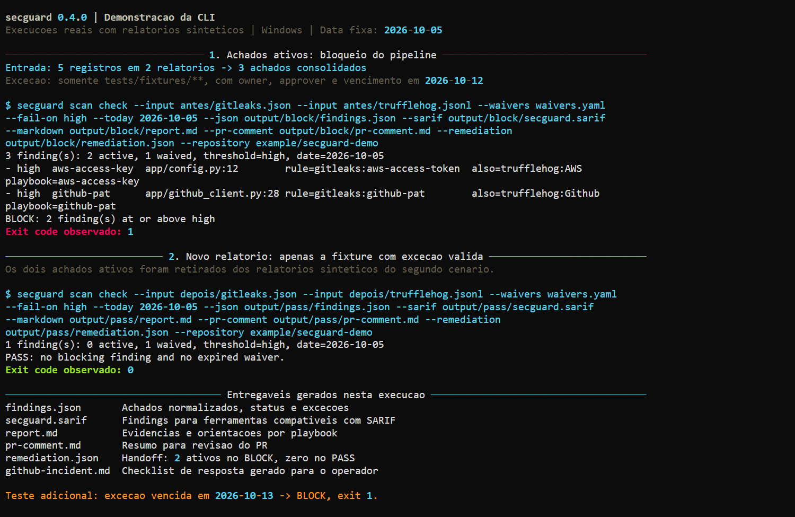

# Secrets Hygiene Kit

Secrets Hygiene Kit is a Python CLI, `secguard`, for teams that already run
Gitleaks, Betterleaks, TruffleHog or detect-secrets. It combines their reports, enforces expiring
waivers and produces JSON, SARIF and Markdown reports with response guidance.

Version **1.0.0** defines a [stable 1.x contract](compatibility.md). The supported
runtime matrix is Linux, Windows and macOS with Python 3.12, 3.13 and 3.14.

[Install the versioned release](https://github.com/lucashgrifoni/secrets-hygiene-kit#install-100),
then follow the [quickstart](quickstart.md) or reproduce the [demonstration](demo.md).

The capture records the 0.4.0 CLI using constructed reports. It is a historical
example; the [compatibility guide](compatibility.md) describes the 1.0 contract
and migration from 0.5.0.

The CLI processes reports locally. Your scanner performs detection; an authorized
responder handles credential revocation and rotation. The remediation exchange
is a stable file format; the optional Hub Python bridge remains experimental
and tracker output is a preview. [OPA and DefectDojo](integrations.md)
consume optional file exports. Canonical JSON can be reimported with the current
catalog and waiver policy; detector claims remain imported report data.

For changes to this repository, see [repository CI and required checks](repository-ci.md).
